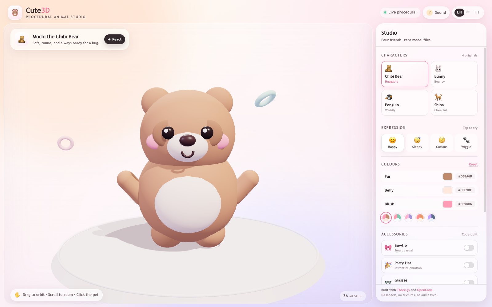
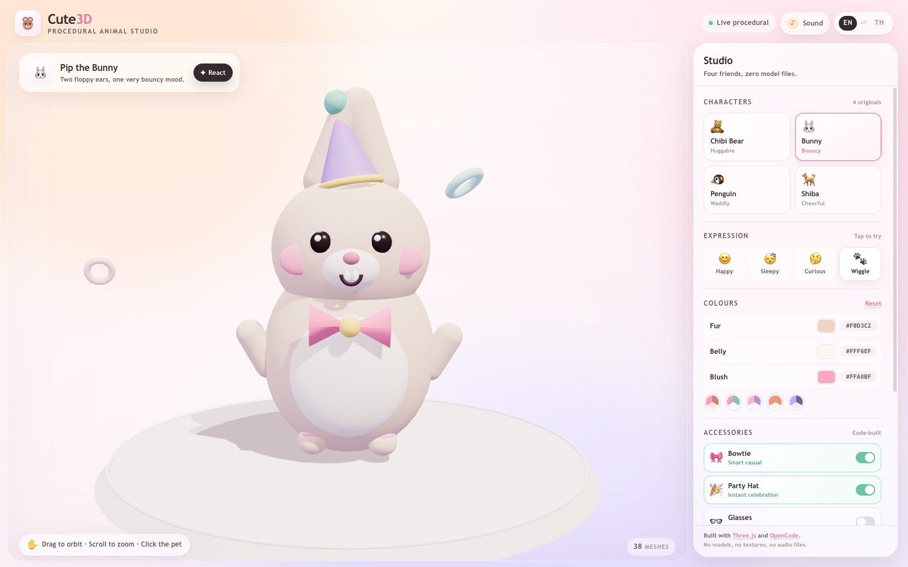
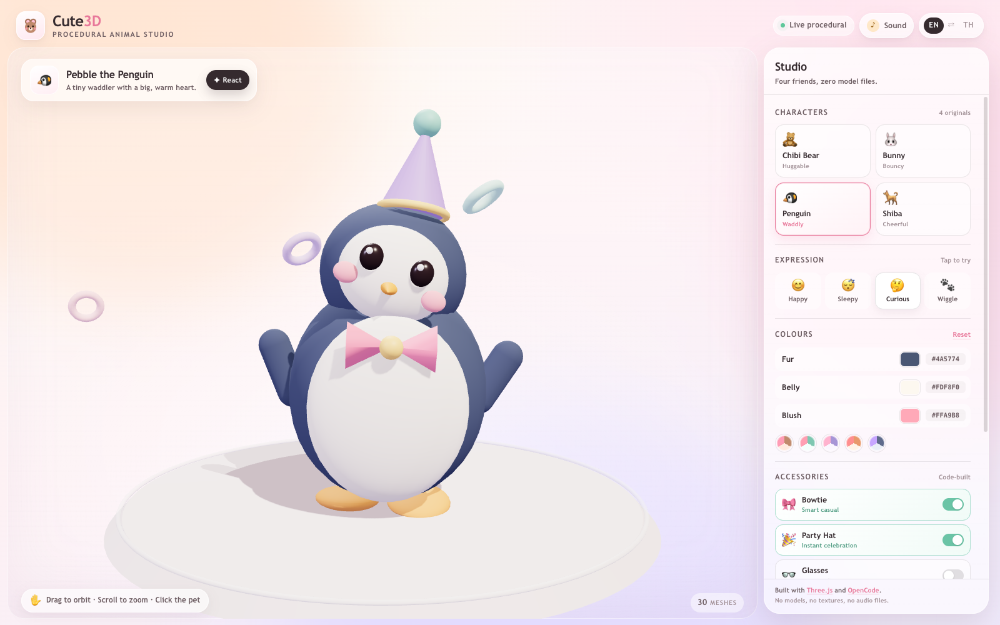
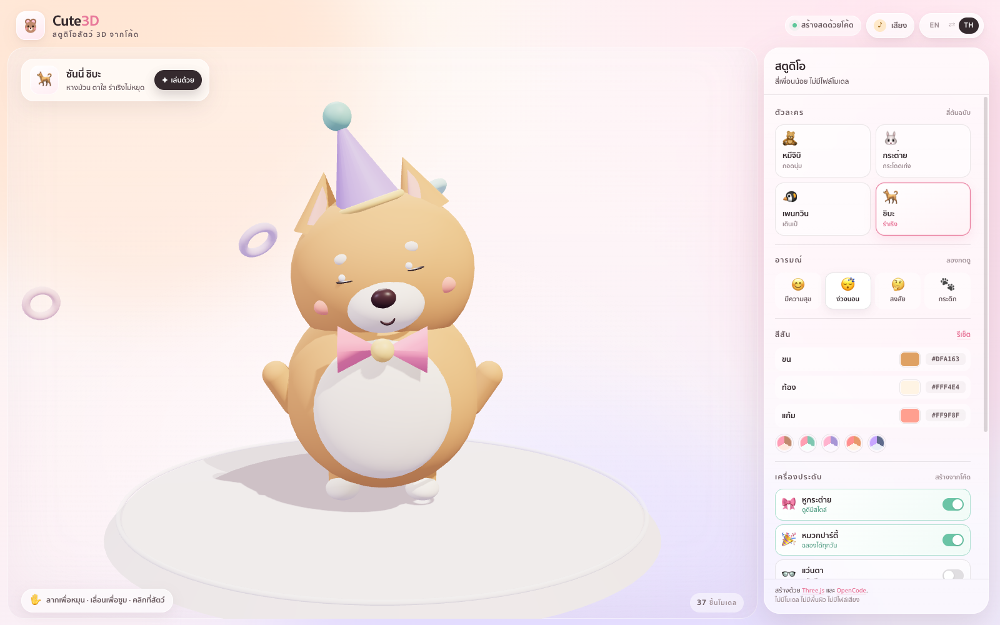
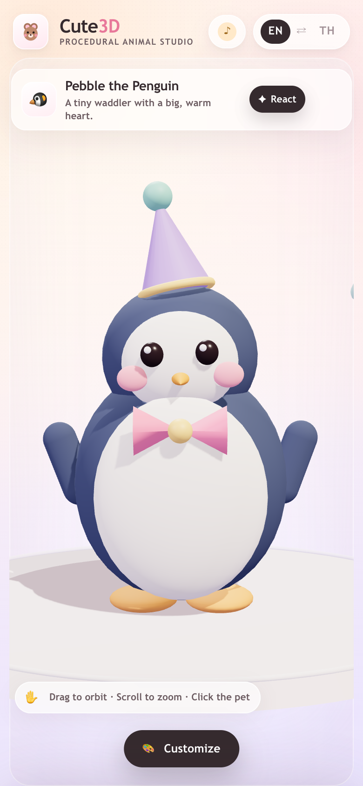

# Cute3D — Procedural Code-Only Animal Studio

**Four original 3D pets, built at runtime from spheres, capsules, cones and torus arcs. No model
files, no textures, no audio files — just Three.js and a few thousand lines of vanilla JavaScript.**

[](https://somphol.github.io/cute3d-animal-studio/)
[](https://threejs.org)
[](LICENSE)
[](docs/TESTING.md)



## Live demo

**<https://somphol.github.io/cute3d-animal-studio/>**

English and ไทย are both first-class. Drag to orbit, scroll to zoom, click the pet. Everything else
lives in the customizer panel.

## What it is

A static character studio that generates every mesh, every expression and every sound in the browser:

- **Four original characters** — Mochi the Chibi Bear, Pip the Bunny, Pebble the Penguin and Sunny the
  Shiba. All proportions and faces are designed from first principles. No third-party mascots,
  licensed characters or copied designs.
- **A real 3D studio** — PCF soft shadows, hemisphere + key + fill + rim lighting, ACES tone mapping,
  a pastel clay pedestal and damped orbit controls.
- **Procedural life** — breathing, floating, blinking (including occasional double blinks), ear
  wiggles, tail wags, penguin waddle and a squash-and-stretch jump-and-spin reaction.
- **A full customizer** — four characters, four expressions, three live colour pickers, five curated
  palettes, three code-built accessories.
- **Synthesized audio** — Web Audio oscillators produce boings, chimes, pops and soft blink ticks.
  Zero `.mp3` or `.wav` files.
- **Bilingual UI** — a complete English/Thai dictionary covering every label, toast and character
  name; the choice persists.
- **Local-first** — colour presets and studio state live in `localStorage`. Share links encode the
  whole look in the URL.
- **Transparent export** — a 2048 × 2048 RGBA PNG of the character with the studio props hidden.



## Quick start

No build step, no install:

```bash
git clone https://github.com/somphol/cute3d-animal-studio.git
cd cute3d-animal-studio
python3 -m http.server 4173
# open http://localhost:4173
```

or, with Node 20+:

```bash
npm start          # scripts/serve.mjs, port 4173 by default
```

Opening `index.html` directly with `file://` works in some browsers but ES modules and the import map
are more reliable over HTTP.

### Controls

| Input | Action |
| --- | --- |
| Drag | Orbit the camera |
| Scroll / pinch | Zoom (4.1–11.5 units) |
| Click / tap the pet | Jump, spin and sparkle |
| `1`–`4` | Switch character |
| `Space` | React |
| `S` | Download a snapshot |
| `L` | Toggle English / ไทย |
| `Esc` | Close the mobile customizer or self-test |

## Features in detail

| Area | What ships |
| --- | --- |
| Renderer | WebGLRenderer, alpha, antialias, PCFSoftShadowMap, ACESFilmic, sRGB output, DPR capped at 2 |
| Lighting | Warm key with 2048² shadows, cool fill, white rim, hemisphere sky/ground, contact shadow |
| Characters | 25–29 meshes each, shared low-segment primitives, per-rig material set |
| Animation | Damped expression blending, deterministic blink seeds, breathing belly, ear/tail rigs, reaction physics |
| Customizer | 4 characters · 4 expressions · 3 colours · 5 palettes · 3 accessories · reset |
| Audio | Six sound patterns, lazy AudioContext, master gain + compressor, persistent mute |
| i18n | 93 EN keys and 93 TH keys, parity-tested; `<html lang>` and meta description update live |
| Persistence | Studio state, language, presets (max 10) and sound preference |
| Export | 2048² transparent PNG; filename `cute3d-<animal>-<YYYY-MM-DD>.png` |
| Share | `?a=…&c=…&x=…&o=…&l=…`, sanitized on read |
| Verification | 19 engine checks, 75 static checks, 23 browser checks, 19 in-page checks |
| Accessibility | Skip link, focus rings, aria-pressed toggles, reduced-motion mode, keyboard shortcuts |

## Verification

```bash
npm test              # engine + repository (no browser)
npm run test:browser  # real headless Chrome, 23 checks
npm run verify        # everything
npm run shots         # regenerate assets/ from a live render
```

| Layer | Command | Expected |
| --- | --- | --- |
| Pure engine | `node --test tests/engine.test.mjs` | 19/19 |
| Repository | `node --test tests/static.test.mjs` | 75/75 |
| Browser | `node tests/browser.test.mjs` | 23/23, zero console errors |
| In-page | `/?selftest` | 19/19 |
| Live copy | `TEST_URL=https://somphol.github.io/cute3d-animal-studio/ node tests/browser.test.mjs` | 23/23 |

Screenshots are regenerated from the real app, not mocked:





## Project layout

```
.
├── index.html                 # shell, import map, panel markup (64 i18n hooks)
├── style.css                  # design tokens, glass panel, HUD, responsive sheet
├── script.js                  # ENGINE + I18N blocks, four rigs, animation, audio, UI
├── manifest.webmanifest       # installable metadata
├── assets/                    # SVG icon, eight generated PNGs (OG card + stills)
├── docs/                      # architecture, reproduction, design, testing, release…
├── scripts/
│   ├── serve.mjs              # zero-dependency static server
│   └── screenshot.mjs         # regenerates every asset from headless Chrome
├── tests/
│   ├── engine.test.mjs        # pure functions, dictionaries
│   ├── static.test.mjs        # repository, metadata, IP hygiene
│   ├── browser.test.mjs       # CDP suite (no npm dependencies)
│   └── lib/                   # static server + Chrome harness, fixtures
├── AGENTS.md                  # handoff for the next agent
├── state.json                 # measured build time, tokens, artifacts
└── LICENSE                    # MIT
```

## Design and originality

Every character is an original composition of primitives. The palette is a warm clay studio:
cream, rose, lavender and mint. Faces use generic button eyes, blush discs, rounded muzzles and
simple smiles — no trademarks, no mascot silhouettes and no copied colour schemes.

The full design rationale, including why the belly patches sit slightly forward of the body shell and
how the snapshot camera is framed, is in [docs/DESIGN.md](docs/DESIGN.md) and
[docs/ANIMATION.md](docs/ANIMATION.md).

## Browser support

Chrome/Edge 111+, Safari 16.4+, Firefox 121+ (import maps, ES modules, Web Audio, `ResizeObserver`).
WebGL 1 is sufficient; the app requests a high-performance context and falls back to SwiftShader in
headless tests. The Three.js CDN is required on first load; after that the page is fully local.

## Credits

Built in a single session with **OpenCode** and **DeepSeek V4.1 Flash**. Three.js is the only runtime
library. Exact elapsed time and token usage are recorded in [state.json](state.json) and discussed in
[docs/CREDITS.md](docs/CREDITS.md).

## Licence

[MIT](LICENSE) © 2026 Somphol Boonjing. Three.js is MIT-licensed; see
[THIRD_PARTY_NOTICES.md](THIRD_PARTY_NOTICES.md).
